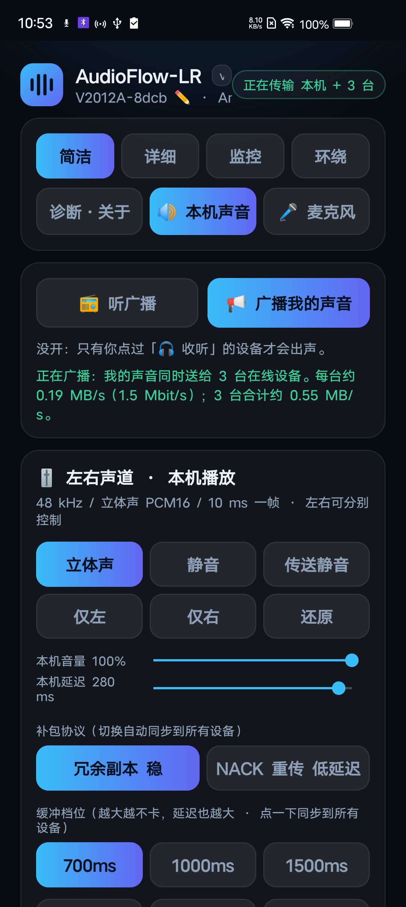
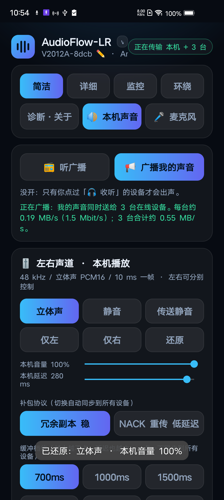
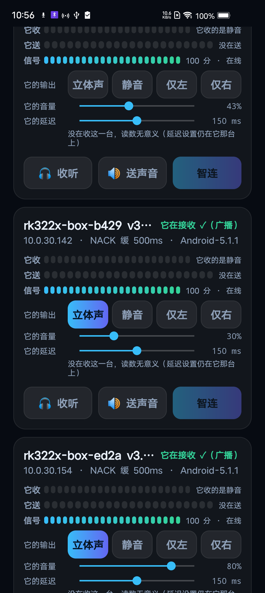
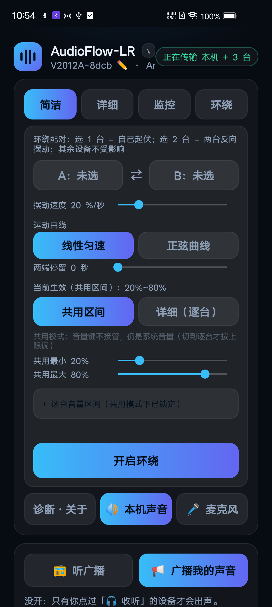
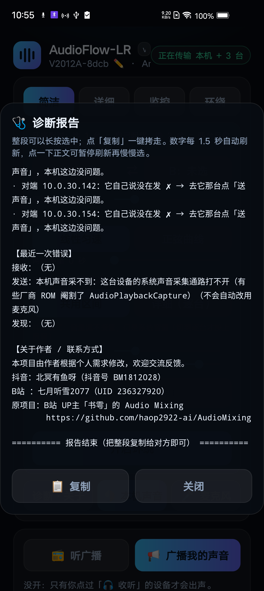

# AudioFlow-LR

> **联系作者 / 关注作者**：
> [抖音 · 北冥有鱼呀（抖音号 BM1812028）](https://www.douyin.com/search/BM1812028)
> ｜
> [B站 · 七月听雪2077（UID 236327920）](https://space.bilibili.com/236327920)
>
> 欢迎关注、交流反馈，有任何问题都可以通过上面两个平台联系到作者。

> 音频流转 · 左右声道版 —— 把一台设备的声音实时同步到全屋音箱，并为每台设备独立分配左右声道。

> 把一台设备的声音，实时、低延迟地同步到全屋多台音箱与旧电视盒子；还能给每台设备单独指定左声道、右声道，或者立体声。

一个零依赖、仅约 200 KB 的 Android 应用。它把你家吃灰的旧手机、电视盒子、蓝牙音箱变成一组同步播放的分布式音响。

## 致谢与项目来源

本项目**借鉴自 B 站 UP 主「书雩」的开源项目 [Audio Mixing](https://github.com/haop2922-ai/AudioMixing)**，在其基础上根据作者自己的使用需求深度修改而来——包括左右声道独立分配、自研环绕音效、冗余副本 / NACK 双补包协议、安卓 5.1 老设备适配等。没有原项目的开源分享，就没有这个项目，在此向书雩同学表示诚挚感谢！

> 原项目 [haop2922-ai/AudioMixing](https://github.com/haop2922-ai/AudioMixing) 采用 **PolyForm Noncommercial 1.0** 协议（个人/非商业用途免费，商用需授权）。本项目为非商业的个人改版，同样尊重并遵循原作者的许可声明。

**主力设备：斐讯 R1 智能音箱。** 本项目正是围绕斐讯 R1 作为接收端打造并长期实测的——把 R1 装上 APK 就能并入全屋同步音响，左声道、右声道随意分配，是作者日常在用的核心设备。

---

## 为什么做这个

家里往往有好几个音箱和旧盒子，但：

- 蓝牙一次只能连一个设备；
- 系统投屏延迟高、容易卡；
- 旧电视盒子（安卓 5.1 / 斐讯 / S905L3A 这类）根本装不上新 App。

这个项目用 WiFi 局域网 + UDP 音频流解决了这三件事：**一台广播，多台同时收；缺包能补，低延迟还不卡；最低支持安卓 5.1，老盒子原地复活。**

## 核心特性

### 🔊 多设备同步播放
一台设备广播声音，局域网内所有接收端同时播放。手机上实时显示每一台的收包状态：

- 是否正在接收、收了多少包、丢了多少包、接收了多少 MB、信号几分；
- 对方的版本号、补包协议、实际缓冲毫秒数都写在设备卡片上，实时更新。

### 🎧 自研左右声道 + 环绕音效（本项目的灵魂功能）
这是作者**自己研究、从零写进软件里**的核心玩法，也是它和普通投屏最大的不同——它不只是"把声音传过去"，而是能把一群设备变成可编排的声场。

**① 左右声道自由分配**

- **按设备分配**：A 设备进左耳、B 设备进右耳，两台音箱一左一右组成立体声；
- **全局声道矩阵**：立体声 / 单声道 / 仅左 / 仅右 / 左右互换；
- 左右独立音量、平衡调节，还可以一键"测左 / 测右 / 测双"快速校验；
- 增益只在自己的 PCM 上做，绝不改动系统音量。

**② 不一定是分左右——每台设备一起调声音大小的"环绕音效"**

这是作者自研的环绕功能，重点不在"左/右"，而在"让多台设备联动起来改变声音的空间感"：

- **环绕配对**：选 1 台 = 它自己音量起伏；选 2 台 = 两台**反向摆动**（一强一弱来回扫），其余设备不受影响；
- **摆动节奏可调**：摆动速度（%/秒）、运动曲线（线性匀速 / 正弦曲线）、两端停留时间；
- **每台设备各自的声音区间**：A 组、B 组可分别设置最小 / 最大音量，形成"此起彼伏"的环绕感；
- **全体一起调**：共用最小 / 最大区间 + 整体音量，按音量键即可等比增减，"每台按自身区间"联动；
- 典型玩法：两台斐讯 R1 分置房间两端，开启反向摆动 + 正弦曲线，声音就在两台音箱之间来回流动。

### ⚡ 两种补包协议，可按设备切换
| 协议 | 原理 | 缓冲 | 适合场景 |
| --- | --- | --- | --- |
| **冗余副本**（稳） | 每包附带一份 640ms 前的旧包兜底 | 700 / 1000 / 1500ms 三档 | 网络抖动大、求稳 |
| **NACK 重传**（低延迟） | 接收端发现丢包才按需请求补发 | 固定 500ms | 求低延迟、不卡 |

- 切换协议时，所有在线设备**自动同步**到同一模式；
- 两种协议各自记住本机延迟，切回来自动恢复；
- 拖动本机延迟滑杆会实时同步给所有接收端；
- 诊断页显示 NACK 请求/命中的收发计数，效果看得见。

### 🧰 兼容到安卓 5.1
为老旧设备做了大量底层适配，以下设备均已实机验证：

- **斐讯 R1 智能音箱**：本项目的主力接收端，长期日常使用；装上 APK 即可作为分布式音响节点，支持左右声道独立控制；
- **S905L3A / CM311-1A / UNT403A 系列盒子**：针对这类弱芯片盒子做了音频线程优先级、缓冲水位、underrun 自愈优化（含 720×480 小屏机型）；
- `minSdk 22`（Android 5.1），重写音频兼容层，绕开新版 API；
- 纯系统 API、零第三方依赖，不会因依赖冲突在老机器上装不上；
- APK 仅约 200 KB，弱网也能秒装。

> 如果你的设备和上面型号不同，只要能装 APK、跑 Android 5.1 及以上，一般也能用。

### 🛠 其它工程能力
- 设备自动发现（UDP 信标，WiFi + 蓝牙双链路合并为同一节点）；
- 智连自动接听、环绕音效、分应用音量、音量键接管；
- 卸载/掉线自动释放投屏授权，不残留"正在投屏"状态栏；
- 内置诊断报告与事件日志，出问题能自查。

## 界面截图

**主界面（简洁页）** —— 音源选择、左右声道、缓冲档位、设备列表一目了然：



**左右声道 / 设备控制** —— 全局声道矩阵与逐台设备的收发、声道、音量控制：



**详细设备控制** —— 每台设备独立设置"它进我耳 / 它的输出"、静音/仅左/仅右、信号质量：



**环绕音效面板（作者自研）** —— 环绕配对、摆动速度、运动曲线、共用区间与整体音量联动：



**诊断 / 关于** —— 一键诊断报告，末尾附有作者联系方式与原项目致谢：



## 改版历程

版本从 v2.21 一路迭代到 v3.04，几十个版本持续打磨：

- **v2.21–v2.30**：多设备流转 + 环绕声 + 链路统计，融合左右声道控制；音量同步、回声抑制、智连自动接听、端口自动选择。
- **v2.31–v2.60**：分应用音量（MediaSession）、投屏授权释放、采集音量链路修正、静音档位意图记忆、设备身份与扩展段（跨网卡/蓝牙合并节点）。
- **v2.97–v3.03**：新增可切换的 **NACK 重传协议**；协议/缓冲/延迟跨设备同步；诊断命中计数；两套缓冲档位分离；设备卡片实时显示版本/协议/实际缓冲；本机延迟按协议分套记忆并自动同步；监控页改为真实收发统计。
- **v3.04**：品牌化改版 —— 统一命名 **AudioFlow-LR**；全新 logo（蓝色渐变 + 白色声波 + L/R）；诊断入口升级为「诊断·关于」，报告末尾附作者联系方式与原项目致谢。

## 快速开始

1. 下载 `releases/` 目录下最新的 APK（或到 Releases 页面下载）；
2. 安装在两台及以上、处于同一 WiFi 的设备上；
3. 在广播端选择"广播我的声音"，在接收端选择"听广播"；
4. 需要低延迟时把补包协议切到 **NACK 重传**，求稳则留在 **冗余副本**；
5. 在声道设置里给每台设备指定左 / 右 / 立体声。

> 采集"本机正在播放的声音"需要 Android 10+ 的投屏授权；低于该版本可用麦克风作为音源。

## 构建

项目没有 gradlew，统一用内置脚本构建（自带签名与单元测试校验）：

```bash
python build_apk.py
```

构建脚本会跑 `tools/` 下的纯 JDK 单元测试（声道矩阵、音量策略、缓冲/丢包等），通过后输出带版本号的 APK。

## 目录结构

```
app/src/main/java/com/audiomixing/app/
  Engine.java        全局状态、协议切换、跨设备控制、统计
  AudioSend.java     采集 + 冗余副本 + NACK 补发 + UDP 发送
  AudioRecv.java     抖动缓冲 + NACK 请求 + 混音播放
  ChannelRouter.java 左右声道路由矩阵（零安卓依赖，可单测）
  Discovery.java     设备发现 / 信标 / 控制通道
  MixService.java    常驻前台服务，持有投屏授权
  ...
tools/               纯 JDK 单元测试与探针
```

## 开源协议

本项目遵循 **PolyForm Noncommercial 1.0** 协议（个人 / 非商业用途免费使用、修改、分发，商用需另行获得授权）——与原项目 [Audio Mixing](https://github.com/haop2922-ai/AudioMixing) 保持一致。见 [LICENSE](LICENSE)。

---

如果这个项目让你家的旧音箱重新响了起来，欢迎点个 Star ⭐。
